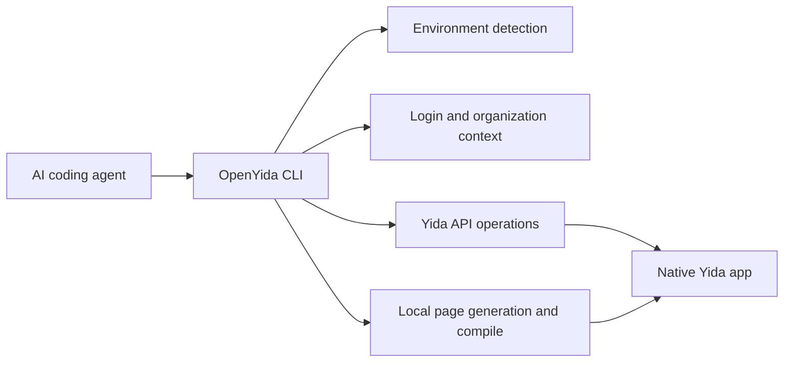

<div align="center">


# OpenYida

**AI-native CLI for building DingTalk Yida low-code applications.**

OpenYida connects AI coding agents with Yida's low-code platform, so developers can create apps, forms, workflows, custom pages, reports, integrations, and deployment configuration from a normal chat-driven development workflow.

[Quick Start](#quick-start) · [帮助网站&文档](https://demo.aliwork.com/o/openyida/helpCenter) · [Capabilities](#capabilities) · [Full Capability List](https://demo.aliwork.com/o/openyida/helpCenter?openyidaPath=capabilities) · [CLI Reference](https://demo.aliwork.com/o/openyida/helpCenter?openyidaPath=features/skills) · [Examples](https://demo.aliwork.com/o/openyida/helpCenter?openyidaRoute=showcase) · [Contributing](./CONTRIBUTING.md) · [Changelog](https://demo.aliwork.com/o/openyida/helpCenter?openyidaRoute=changelog) · [Application Previews](#application-previews)

[](https://www.npmjs.com/package/openyida)
[](https://www.npmjs.com/package/openyida)
[](https://github.com/openyida/openyida/actions/workflows/ci.yml)
[](./LICENSE)
[](https://nodejs.org)

[English README](./README.md) · [简体中文 README](./README_zhCN.md)

</div>

---

## What OpenYida Provides

OpenYida is a bridge between AI coding tools and Yida. It gives agents a stable `openyida` CLI to create resources, inspect schemas, generate source code, compile and publish pages, and diagnose issues.

The result remains a native Yida application: teams can continue editing it in Yida, use existing enterprise security controls, and deploy through the Yida platform.

## Application Previews

Example applications built with the themes below. Click an image to view it at full size. These are visual references, not ready-made business applications: content, data, brand colors, and layouts are adapted to your requirements.

<table>
  <tr>
    <td width="50%" align="center"><strong>Dark Rail · Fine Lines</strong><br><a href="https://img.alicdn.com/imgextra/i1/O1CN01oFp7XMYEjSI5r31K_!!6000000006946-2-tps-2884-1794.png"></a></td>
    <td width="50%" align="center"><strong>Soft Inset Surfaces</strong><br><a href="https://img.alicdn.com/imgextra/i3/O1CN01UEEmuLlMF3I5pHky_!!6000000006290-2-tps-2870-1798.png"></a></td>
  </tr>
  <tr>
    <td width="50%" align="center"><strong>Sage</strong><br><a href="https://img.alicdn.com/imgextra/i1/O1CN01NiHI4pBsbOK5qIC4_!!6000000007377-2-tps-2878-1798.png"></a></td>
    <td width="50%" align="center"><strong>Teal</strong><br><a href="https://img.alicdn.com/imgextra/i2/O1CN01hLAdOTwuEWF5qXno_!!6000000004848-2-tps-2880-1796.png"></a></td>
  </tr>
  <tr>
    <td width="50%" align="center"><strong>Terminal</strong><br><a href="https://img.alicdn.com/imgextra/i3/O1CN01PPHEYDv6nMB5qXnq_!!6000000004777-2-tps-2880-1798.png"></a></td>
    <td width="50%" align="center"><strong>Platinum</strong><br><a href="https://img.alicdn.com/imgextra/i2/O1CN01eDGhh1WCtFI5soHi_!!6000000007333-2-tps-2898-1792.png"></a></td>
  </tr>
</table>

Use an **application theme or an independent creative direction**. Describe a style you like, or provide a reference website or design image to customize your app’s appearance. [Browse more application examples](https://demo.aliwork.com/o/openyida/helpCenter?openyidaRoute=showcase).

## Core Capabilities

| Area | What you can do |
|------|-----------------|
| Application delivery | Create, update, export, and import Yida applications |
| Form modeling | Create forms, update fields, inspect schemas, and manage permissions |
| Custom pages | Generate React-based pages, lint Yida runtime rules, compile, and publish |
| Workflow automation | Create process forms, configure approval flows, preview process instances |
| Data operations | Query form/process/task/subform data and run anomaly checks |
| Integrations | Manage HTTP connectors, connector actions, auth accounts, and automation flows |
| Operations | Diagnose environment issues, manage login state, configure sharing, upload CDN assets |

## From Request to Delivery

1. **Describe the goal.** Explain who will use the app, what they need to do, and any existing app or reference material.
2. **Share requirements and preferences.** Add the business details and appearance preferences that matter to you. Include any colors, websites, or design images you like.
3. **Choose how to build.** Fast suits clear requirements you want to move forward with. Plan produces a reviewable proposal and waits for approval before creating resources.
4. **Review and refine.** Check the delivered app and common actions, then request page, field, or workflow changes. Your chosen style is reused unless you ask to change it.

For existing-app improvements, review the visual proposal before backups and implementation. Restoration uses the saved backups; page content and theme settings need separate backups, with the supported scope explained before changes.

## Recent Updates

**2026.10.14-1** improves appearance customization, with better support for style descriptions, reference websites, and design images. [Read the full changelog](./CHANGELOG.md#20261014-1---2026-10-14).

## Quick Start

### 1. Install

```bash
npm install -g openyida
```

OpenYida requires Node.js 18 or later. The package exposes both `openyida` and `yida` commands.

Global npm installations check for updates at most once a day and update automatically. Run `openyida update` to update manually, or set `OPENYIDA_NO_AUTO_UPDATE=1` to keep your installed version.

<details>
<summary>Auto-update environments and development settings</summary>

Local terminals and AI tools share the same policy. Managed cloud Agent runtimes skip automatic updates. For development and testing, `OPENYIDA_AUTO_UPDATE_SECS` changes the check interval.

</details>

If Codex is already installed, OpenYida also imports a local Codex plugin during postinstall. Restart Codex after installation, then type `@宜搭` or `@openyida` in the composer to attach the OpenYida context.

<details>
<summary>Optional: install DingTalk Workspace CLI (dws)</summary>

For DingTalk A2UI authoring, validation or messaging, install the official [DingTalk Workspace CLI](https://github.com/DingTalk-Real-AI/dingtalk-workspace-cli#installation) separately:

```bash
npm install -g dingtalk-workspace-cli
dws version
```

Alternatively, `openyida dws install` displays official instructions for your platform without running an installer. Once installed, `openyida dws <command> [args]` forwards arguments to your system's dws.

OpenYida does not bundle or automatically install dws. Dws manages its own version, updates and login. Use `dws auth login` for DingTalk business access and verify the target organization and account. Native YiDA cool-card creation, reads and editor links work without dws; updating a chat card through dws does not save a YiDA template. See the official instructions for other installation methods and check the installed command's `--help` before use.

</details>

### 2. Check Your Environment

Run this from the AI coding workspace where you want OpenYida to operate:

```bash
openyida agent-capabilities --summary-json
```

This checks the installed version, login state, and workspace. Use `openyida agent-capabilities --json` for detailed diagnostics.

### 3. Log In

```bash
openyida login
```

OpenYida login defaults to OAuth token mode. It opens the DingTalk OAuth authorization page, receives the local loopback callback, exchanges `code` / `authCode` with the Yida server, and stores `access_token` / `refresh_token` in the user auth store when available. If the user auth store is not writable, OpenYida explicitly falls back to the current project cache and reports that narrower persistence scope.

When the user names a target Yida entry URL, pass it to the login command so OpenYida can select the matching environment and auth profile. For example:

```bash
openyida login https://yida-group.alibaba-inc.com/
openyida login --alibaba
```

For token status checks, use:

```bash
openyida login --check-only --json
openyida auth status
```

To reuse an existing shared login profile for the current project, switch first instead of starting a new OAuth login:

```bash
openyida auth profiles
openyida auth profile switch <auth_profile>
```

If the target profile is not listed, run `openyida login` to add it, then switch to the new profile.

OpenYida does not install Playwright by default.

### 4. Build With an AI Agent

Ask your coding agent for a concrete Yida application or workflow:

```text
Create a CRM application in Yida with customer, contact, opportunity, and follow-up forms.
Use Plan mode to design a procurement app with requests, approvals, and dashboards. Show me the proposal first.
Build an oolong tea brand storefront and order management back office, with navigation groups.
Improve the appearance of this existing app. Show me the proposal first, preserve business logic, and back up before changes.
```

The agent can then call OpenYida commands to create the application, generate source files, publish pages, and return the final Yida URLs. In Codex, QwenWork, Qoder, Qoder IDE, and QoderWork environments, successful creation and publish commands also include a browser handoff so the agent can open the resulting Yida page in the in-app browser. Use `--open` to force this handoff or `--no-open` to suppress it.

## Supported AI Coding Tools

| Tool | Support |
|------|---------|
| [Codex](https://openai.com/codex/) | Full support |
| [Claude Code](https://claude.ai/code) | Full support |
| [MuleRun](https://mulerun.com) | Full support |
| [Cursor](https://cursor.com/) | Full support |
| [Visual Studio Code](https://code.visualstudio.com/) | Full support |
| QwenWork（千问办公） | Full support |
| [Qoder](https://qoder.com/download) | Full support |
| [Qoder IDE](https://qoder.com/ide) | Full support |
| [QoderWork](https://qoder.com/download) | Full support |

## How It Works



OpenYida keeps platform-specific behavior inside the CLI, while agents interact with predictable commands and project files.

## Project Layout

```text
openyida/
├── bin/yida.js                 # CLI entry and command routing
├── lib/
│   ├── app/                    # Application, form, page, import/export commands
│   ├── auth/                   # OAuth token login, token session storage, organization switch
│   ├── connector/              # HTTP connector lifecycle and smart creation
│   ├── core/                   # Environment detection, i18n, diagnostics, data commands
│   ├── process/                # Process form creation, configuration, preview
│   ├── report/                 # Yida report and chart generation
│   └── samples/                # Reusable code templates emitted by openyida sample
├── project/                    # Default workspace template for generated Yida projects
├── yida-skills/                # Source skill docs and Yida API references
└── scripts/                    # CI, packaging, and installation helpers
```

## Capabilities

For a user-facing list of supported features and matching CLI commands, see [OpenYida 功能完整列表](https://demo.aliwork.com/o/openyida/helpCenter?openyidaPath=capabilities).

### Application and Form Management

```bash
openyida create-app --name "CRM" --desc "Customer management"
openyida sample yida-design app-theme --output .cache/openyida/crm/app-theme.css
openyida create-app --name "CRM" --desc "Customer management" --theme-file .cache/openyida/crm/app-theme.css --nav-theme light --logo-source appIcon --layout l_shape
openyida app-list --type managed --page 1 --size 16
openyida update-app APP_XXX --theme-file .cache/openyida/crm/app-theme.css --nav-theme light --logo-source appIcon --layout l_shape
openyida corp-efficiency
openyida create-form create APP_XXX "Customer" .cache/openyida/forms/customer-fields.json
openyida create-form update APP_XXX FORM_XXX .cache/openyida/forms/customer-changes.json
openyida create-form update APP_XXX FORM_XXX --data-file .cache/openyida/forms/customer-changes.json
openyida create-form resume APP_XXX FORM_XXX .cache/openyida/forms/customer-fields.json --json
openyida sample openyida-page-template form-fields --output .cache/openyida/forms/customer-fields.json
openyida sample openyida-page-template canvas-form-drawer --output project/pages/src/customer-entry.canvas.jsx --var APP_TYPE=APP_XXX --var FORM_UUID=FORM_XXX
openyida get-schema APP_XXX FORM_XXX
openyida get-schema APP_XXX FORM_XXX --compact --resolve-fields "Customer Name,Status"
openyida get-schema APP_XXX --all --output-dir .cache/schemas
```

Native forms use a component tree: business fields capture data, tabs switch content, action groups trigger business actions, images establish visual focus, status areas provide feedback, and `Divider` plus `ColumnContainer` organize hierarchy and columns. `create-form` field definitions create 19 business field types plus `Divider` and `ColumnContainer` (mapped to `ColumnsLayout` + `Column`), while updates retain other existing components.

### Custom Page Development

```bash
openyida create-page APP_XXX "Dashboard" --mode dashboard
openyida publish pages/src/home.canvas.jsx APP_XXX FORM_XXX
```

Custom page source is authored directly from PRD and design guidance. Custom page development uses `yida-canvas-custom-page` and `.canvas.jsx`.

For member, department, attachment, and image upload components, `.canvas.jsx` pages should follow `yida-canvas-custom-page/references/native-components-bridge.md` for feature detection, fallback, and value normalization.

For the current custom page native-component support matrix, see [Yida native components supported by custom pages](https://demo.aliwork.com/o/openyida/sample/canvas-native-components).

### Workflow, Data, and Permissions

```bash
openyida create-process APP_XXX "Purchase Request" .cache/openyida/process/fields.json .cache/openyida/process/process.json
openyida configure-process APP_XXX FORM_XXX .cache/openyida/process/process.json
openyida process preview APP_XXX PROC_INST_XXX --output .cache/openyida/process/process.html
openyida data query form APP_XXX FORM_XXX --page 1 --size 20
openyida data query form APP_XXX FORM_XXX --dynamic-order '{"dateField_xxx":"-"}'
openyida data query process APP_XXX FORM_XXX --current-approver USER_ID --count
openyida data create form APP_XXX FORM_XXX --expect-form-name 客户 --expect-form-type receipt --data-file .cache/openyida/data-import/record.json
openyida get-permission APP_XXX FORM_XXX
```

`--current-approver` takes an exact userId, not a display name. It scans running instances and their current TODO records, counts each matching instance once, and respects the current login's server-authorized data scope. Omit `--count` to include matching instance data. An incomplete scan or permission failure is reported as an error; the result does not claim application-wide visibility.

Append and forward permissions are configured in the process definition through `nodes[].actions.normalActions/appendActions`. Both `create-process` and `configure-process` compile these settings into matching designer and runtime properties. See [approval action configuration](yida-skills/skills/yida-flow-node-config/references/actions.md) for the JSON example, defaults, and verification limits.

`configure-process` 的流程 JSON 中，审批人可配置为发起人、指定成员、指定角色、部门主管或直属主管，例如：

```json
{
  "nodes": [
    {
      "type": "approval",
      "name": "主管审批",
      "approver": {
        "type": "user",
        "users": [{ "id": "manager7350", "name": "九神" }],
        "multiApproverType": "all"
      }
    }
  ]
}
```

`configure-process` 会先通过表单绑定和流程版本只读接口证明 `processCode` ownership。目标已有 PUBLISHED 流程或 SAVED 草稿时，整图替换必须在人工确认后显式传入 `--replace`；未确认或 ownership 不匹配时远程写入数为 0。draft/save/publish 均为 one-shot，认证异常返回 `NON_IDEMPOTENT_RESULT_UNKNOWN`，不得自动重试。

发布成功还必须精确回读同一 PUBLISHED `processId/processVersion` 的 `getProcessById` 平台视图，并验证可见节点的组件、名称、顺序和审批模式。只有输出 `verificationLevel: "PLATFORM_VIEW_VERIFIED"` 才表示平台 view 已验证；`PUBLISHED_UNVERIFIED` 表示发布可能已生效但回读不完整，不能宣称 `processJson` 已验证，也不能直接重放写请求。

When creating or updating test data with `openyida data`, Yida date fields must use 13-digit millisecond timestamps, for example `"dateField_xxx": 1719705600000`. Do not submit `YYYY-MM-DD` strings for `DateField` or `CascadeDateField` values.
For deterministic query order, pass `--dynamic-order '{"fieldId":"+"}'` for ascending order or `--dynamic-order '{"fieldId":"-"}'` for descending order. Without `--dynamic-order`, `searchFormDatas` does not guarantee a stable result order; pagination, comparison, and pairing logic must not depend on the default order.
Temporary JSON, CSV, and one-off import scripts should live under `.cache/openyida/` so generated run artifacts do not clutter the repository root.

### Real Environment E2E

Most checks should stay offline, but OpenYida also includes an explicit real-environment smoke path for release and nightly validation:

```bash
OPENYIDA_E2E=1 npm run test:e2e:real
OPENYIDA_E2E=1 npm run test:e2e:real:full
OPENYIDA_E2E=1 OPENYIDA_E2E_FULL_STAGES=auth,app,form,process npm run test:e2e:real:full
npm run test:e2e:real:skills
```

The runner creates a disposable app, form, and custom page with an `OY_E2E_*` prefix, then verifies token login, app listing, schema fetch, data query, and page publish. It writes a registry to `project/.cache/e2e-real/` so created resources can be audited later. Run `openyida login` for the target environment before starting the real E2E runner.

`test:e2e:real:full` extends the smoke path into a broad deterministic feature matrix: auth/env, app update, form update and option mutation, page build/compile/generate/publish, data create/get/update/query, permission read, page config and short URL check, report create/append, dashboard skill verification, export/import, batch, task-center, formula/doctor/sample/CDN config, and local connector parsing/template generation. AI-backed commands such as `flash-to-prd` are available as the optional `ai` stage because they depend on remote model availability. Workflow mutation is available as the opt-in `process` stage; it creates and republishes a workflow on the disposable E2E form and records advanced official-node fixtures for review.

`test:e2e:real:skills` enforces coverage for every directory under `yida-skills/skills/`. Each skill must be classified as real E2E, offline/unit, opt-in, or deprecated with an explicit reason. This prevents new skills from quietly bypassing the real-environment test plan.

Each successful full run leaves a human-inspectable result app in the target organization. The final step publishes a dedicated `Full E2E Dashboard` custom page, renames the app to `OY_E2E_*_PASSED` by default, and prints direct links for the app, form, dashboard page, and report; the same links are saved under `resultApp` in the registry JSON.

Useful options:

| Env var | Purpose |
|---------|---------|
| `OPENYIDA_E2E_PREFIX` | Override the disposable resource name prefix |
| `OPENYIDA_E2E_CORP_ID` | Switch to the dedicated test organization before creating resources |
| `OPENYIDA_E2E_RESULT_APP_NAME` | Override the final app name shown as the full-run result |
| `OPENYIDA_E2E_BASE_URL` | Override the Yida base URL for private deployments |
| `OPENYIDA_E2E_FIELDS_FILE` | Use a custom form fields fixture |
| `OPENYIDA_E2E_PAGE_SOURCE` | Use a custom page source for publish verification |
| `OPENYIDA_E2E_SKIP_PUBLISH=1` | Skip custom page creation and publish |
| `OPENYIDA_E2E_REGISTRY_DIR` | Write registries outside `project/.cache/e2e-real/` |
| `OPENYIDA_E2E_FULL_STAGES` | Comma-separated stage list for `test:e2e:real:full`; use `all` or omit for the default broad matrix |

Use `npm run test:e2e:real:cleanup` to list recorded disposable resources. OpenYida does not yet expose a safe app/form deletion command, so cleanup is intentionally a registry-backed audit step rather than an automatic destructive action.

### Skill Evaluation Harness

The E2E paths above prove the *CLI* works. The eval harness under `scripts/eval/` measures whether the *agent* still routes natural-language requests to the right sub-skill and produces good output after you edit `yida-skills/SKILL.md`. It is the feedback loop for harness engineering.

```bash
# Routing eval — "did it pick the right sub-skill?" No real resources, no login.
# Drives a headless `claude -p` agent with each scenario prompt and checks
# the selected sub-skill against the golden set.
npm run eval:routing

# Doc quality — static analysis of all SKILL.md files (standards + maintainability).
npm run eval:doc-quality

# Safety — credential leak detection, command whitelist, corpId consistency.
npm run eval:safety

# Coverage — how much of the skill/category/reference space is covered by scenarios.
npm run eval:coverage

# Comprehensive — 10-dimension scorecard for a single skill (doc quality, routing,
# safety, step completeness, output validity, efficiency, stability, coverage).
# Outputs a JSON scorecard, SVG radar chart, and trend analysis.
npm run eval:comprehensive -- --skill yida-dashboard

# Tool-pipeline baseline (end-to-end) — wraps the real-environment runner for one
# sub-skill, adds guardrail assertions, screenshots the published page, and writes a
# human scoring template. Runs deterministic CLI commands (no agent) so it serves as
# a control that proves the build→publish→screenshot→score plumbing itself works.
# Requires OPENYIDA_E2E=1 and a valid token session.
OPENYIDA_E2E=1 npm run eval:e2e -- --skill yida-dashboard --screenshot

# Same, plus automatic screenshot scoring via the local multimodal `claude -p`.
OPENYIDA_E2E=1 npm run eval:e2e -- --skill yida-dashboard --screenshot --auto-score

# Real-generation eval — "can one sentence really build a usable app?" Feeds a
# natural-language request ("帮我创建一个订单管理系统") to a headless `claude -p`
# that actually reads the openyida skill and runs the CLI to build a real app, then
# reuses the screenshot + scoring + report pipeline. Creates real 宜搭 resources, so
# it needs OPENYIDA_E2E=1 + an authenticated agent. Unlike the deterministic baseline
# above, here the agent self-orchestrates.
OPENYIDA_E2E=1 npm run eval:generate -- --screenshot

# Re-evaluate an archived real CLI trace against the latest scenario contract and
# current read-only platform state. This does not run an agent or mutate resources.
npm run eval:replay -- --report <generation-report.json> --scenario <scenario.json> --app-type APP_XXX

# Run all three in one pass (routing + tool-pipeline baseline + real generation).
OPENYIDA_E2E=1 npm run eval:all -- --skill yida-dashboard --screenshot

# Optional: a zero-dependency local web console (buttons + live streamed output)
# that runs the tasks above on click. Binds to 127.0.0.1 only; tasks are a fixed
# whitelist. Use the Node version you start it with, so run `nvm use 20` first.
npm run eval:dashboard          # http://127.0.0.1:4500

```

Configuration precedence is `CLI flag > env (OPENYIDA_EVAL_*) > scripts/eval/eval.config.json > defaults`.

| Flag | Purpose |
|------|---------|
| `--mode e2e\|routing\|generate\|doc-quality\|safety\|coverage\|comprehensive\|all` | Which evals to run (default `e2e`) |
| `--skill <name>` | Restrict the e2e run to one sub-skill; stages are reverse-looked-up from the `SKILL_COVERAGE` matrix |
| `--stages a,b` | Explicit stage list, overriding the skill reverse-lookup |
| `--runs N` | Multi-run stability: repeat routing N times, report consistency rate |
| `--screenshot` / `--no-screenshot` | Capture the published page (default on; skipped gracefully if Playwright is absent) |
| `--auto-score` / `--no-auto-score` | Score screenshots with the local `claude -p` agent (default off → human template only) |
| `--scenarios <dir>` | Routing golden-set directory (default `scripts/eval/scenarios`) |
| `--gen-scenarios <dir>` | Real-generation golden-set directory (default `scripts/eval/scenarios/generation`) |

Results are written back into the existing `acceptance-manifest.json` under a new `eval` section (guardrails, screenshots, scores) plus two sibling artifacts: a `scoring.md` human-scoring template and a self-contained `eval-report.html` visual report (screenshots inlined as base64, so the single file opens anywhere). Routing results land in `project/.cache/eval/routing-report.json`; generation results (with their own `scoring.md` + `eval-report.html`) land in `project/.cache/eval/generate/gen-<timestamp>/`. The harness degrades gracefully: a missing Playwright skips screenshots (enable with `npm install --no-save playwright && npx playwright install chromium`), and a missing `claude` CLI skips auto-scoring while keeping the human template. A guardrail failure (for example a resource-creating command issued before a successful `login --check-only`) fails the run.

A zero-dependency local dashboard (`npm run eval:dashboard`, then open `http://127.0.0.1:4500`) drives these runs from buttons and streams output live; its "📊 查看最新报告" button opens the most recent `eval-report.html`.

### Connectors, Integrations, and Reports

Automation spec `sendMessage` nodes accept `toRoles: [{"roleCode":"REAL_ROLE_ID","roleName":"Finance"}]` for NORMAL messages, alongside users and member fields. Process approval, operator, and CC nodes can also select roles. Role selection differs from conditional actor selection, which does not yet have a complete CLI shorthand. See the `yida-flow-node-config` skill for shared node guidance.

```bash
openyida connector smart-create --curl "curl https://api.example.com/users"
openyida connector list
openyida integration create APP_XXX FORM_XXX "Sync customer data"
openyida integration create APP_XXX FORM_XXX "Approval result notify" \
  --events processFinish --approval-actions agree,disagree --receivers 123456
# Capability probe only; currently fails closed before auth/spec reads/remote writes
openyida integration update APP_XXX FORM_XXX LPROC_XXX \
  --spec .cache/openyida/integration/desired-spec.json
openyida create-report APP_XXX "Sales Dashboard" .cache/openyida/reports/charts.json
openyida append-chart APP_XXX REPORT_XXX .cache/openyida/reports/chart.json

# Aggregate tables use two independent optimistic-concurrency axes.
openyida aggregate-table inspect APP_XXX FORM_XXX --json
openyida aggregate-table preview APP_XXX FORM_XXX .cache/openyida/aggregate/design.json --json
openyida aggregate-table save APP_XXX FORM_XXX .cache/openyida/aggregate/design.json --json --no-open
openyida aggregate-table publish APP_XXX FORM_XXX .cache/openyida/aggregate/design.json --json --no-open
openyida aggregate-table status APP_XXX FORM_XXX --json
```

Aggregate-table `save` verifies the draft `stashGmtModified` axis; `publish` verifies the live `gmtModified` axis. Both commands require the corresponding GET readback revision to advance; when a response revision exists it must equal that readback axis. Both commands also require canonical readback of `relationForms`, `relationships`, `aggregatedFields`, `auxFields`, `formulaFields`, and `validators`. The CLI intentionally does not expose aggregate-table deletion, AI authoring, a high-level design DSL, or tenant-dynamic limits until the corresponding platform contracts are proven.

The opt-in aggregate real-E2E runner additionally requires `OPENYIDA_AGGREGATE_E2E_RUN_ID` and an exact `OPENYIDA_AGGREGATE_E2E_OWNED_MARKER` beginning with `<runId>__`. Before its first write it verifies the exact list/inspect identity and name, persists a redacted manifest, registry, and baseline snapshot, then conditionally restores the baseline using the latest live revision. Missing ownership proof or concurrent revision movement produces `PLATFORM_PROBE_REQUIRED` / `restore_blocked` without a restore write.

## CLI Reference

Run `openyida --help` or `openyida <command> --help` for detailed usage.

### Report a problem or contribute a fix

Tell your AI: “OpenYida keeps failing. Analyze the cause and prepare feedback.” You can prepare a redacted report and reproduction steps without a GitHub account or a local source checkout. Preparing a report does not submit it.

```bash
openyida feedback report --input summary.json --output-dir feedback-draft-001
```

Your AI prepares the summary from observed evidence and selected reproduction screenshots. PRs include before/after test comparisons. Before anything is published, review the final text and images, confirm sensitive information, and remove anything you do not want to share. See the [report input format](yida-skills/skills/yida-feedback/references/report-input.md). Review business information before sharing. With a GitHub account, authorize your AI to submit an Issue or contribute a verified public OpenYida fix through your personal Fork. Without an account, create a GitHub account first. If that is not possible, share the report in the AI开发者群 (AI developer group).

To configure a submission tool, your AI can first run `openyida feedback github setup --json` to check gh and the current account. After you approve the installation plan, it can run `openyida feedback github setup --install --confirm --json`, using existing Homebrew on macOS/Linux or WinGet on Windows. Without a supported manager, official instructions or the web remain available. Browser authorization is a separate step performed by you; installation does not log you in, request passwords or tokens, or replace public-content approval. Resume the original draft after setup. See the [account and tool guide](yida-skills/skills/yida-feedback/references/github-setup.md).

When preparing a PR that needs a personal Fork, or when you ask how to support the project, the feedback Skill can inspect account support state with `openyida feedback github status --json`. Star and a personal Fork are optional: `feedback github star --confirm` and `feedback github fork --confirm` run only after you choose them. Existing actions are reused. This check is separate from installation and automatic updates; neither action is required to submit an Issue.

<!-- OPENYIDA_COMMANDS_START -->
<!-- This section is generated by `npm run docs:commands`. Do not edit command rows by hand. -->

### Auth & Environment

| Command | Description |
|---------|-------------|
| `openyida login [target-url] [--env <name>\|--intl\|--overseas\|--global\|--yidaapps\|--alibaba] [--client-id <clientId>] [--endpoint <url>] [--no-browser]` | Login with OAuth token mode |
| `openyida logout` | Logout / unbind current project auth |
| `openyida auth <status\|login\|refresh\|logout\|profiles\|profile switch>` | Token login state and profile management |
| `openyida org <list\|switch> [--json] [--corp-id <corpId>]` | Organization management (list / switch existing profiles first) |
| `openyida env [--json\|setup\|list\|show\|switch\|add\|remove] [options]` | Detect AI tool environment & token login state |

### App Management

| Command | Description |
|---------|-------------|
| `openyida app-settings <appType> [--section theme\|basic\|data-card\|cool-card] [--json]` | Read theme, frontend/backend, native data card and cool card management links |
| `openyida cool-card <list\|templates\|create\|get> <appType> [cardPageCode] [--type im\|onebox] [--name <title>] [--page <n>] [--size <n>] [--search <text>] [--out <file>] [--json]` | Create and read native YiDA cool cards (interactive and pinned) |
| `openyida data-card <list\|create\|get\|save\|publish\|probe\|release-get\|release-save\|release-check\|release-test\|refs> <appType> [cardCode] [--name <title>] [--description <text>] [--schema <file>\|--config <file>] [--expected-hash <hash>] [--backup <file>] [--out <file>] [--published\|--version <version>] [--page <n>] [--size <n>] [--search <text>] [--allow-send] [--json]` | Create, configure, publish and distribute native YiDA data cards |
| `openyida plugin <dev-list\|get\|version-list\|version-get\|extensions\|installed-list\|installed-get\|runtime-list\|probe\|create\|create-version\|save-dev\|configure\|enable\|disable\|upgrade\|uninstall> [pluginId] [version] [options]` | Manage YiDA platform plugin versions, installation state, and runtime registrations |
| `openyida app-entry get <appType> [--json]` | Read frontend and management runtime entries |
| `openyida app-entry set <appType> [--frontend <url>\|--frontend-page <formUuid>] [--management <url>\|--management-page <formUuid>] [--clear-frontend] [--clear-management] [--json]` | Register application entries with partial update and readback |
| `openyida app-list [--type managed\|created] [--page N] [--size N]` | Page through apps I manage or created |
| `openyida solution-template <search\|detail\|ai-build\|enable\|status> [templateId\|requestId] [options] [--json]` | Discover and inspect Solution Center templates, then use native AI build or direct enable |
| `openyida corp-efficiency [overview\|details\|detail\|groups\|notify] [options] [--open\|--no-open]` | Query enterprise efficiency overview and detail reports |
| `openyida create-app "<name>"\|--name <name> [options] [--locale zh_CN\|en_US\|ja_JP] [--open\|--no-open]` | Create a Yida app |
| `openyida design-plan catalog [--json]` | List available planning themes and page patterns |
| `openyida design-plan init <requirement-brief.json> [--theme-id <id>] [--output-dir <dir>] [--json]` | Initialize a plan draft from confirmed requirements |
| `openyida design-plan preview <build-plan.json> --part-file <module.json> [--json]` | Update plan drafts by module |
| `openyida design-plan materialize <build-plan.json> [--from-preview \| --business-file <json> --visual-file <json>] [--output-dir <dir>] [--rebase-parts] [--check] [--json]` | Generate or update plan documents and theme with consistency checks |
| `openyida design-plan patch <build-plan.json> --set <path=value> [--set <path=value> ...] [--materialize] [--output-dir <dir>] [--json]` | Patch plan fields and optionally sync documents and theme |
| `openyida update-app <appType> [--name "..."] [--desc "..."] [--icon <name>] [--icon-color <color>] [--colour <key>] [--theme-color <color>] [--theme-file <css>] [--confirm-legacy-app-style] [--disable-custom-theme] [--nav-theme light\|dark\|white\|gray] [--logo-source appIcon\|customImage] [--layout side\|top\|l_shape] [--hide-app-nav\|--show-app-nav]` | Update app info |
| `openyida data-manage-style guide [--json]` | Inspect data-management UI directions, tokens and scoped CSS guidance |
| `openyida data-manage-style list [--json]` | List optional data-management recipe examples |
| `openyida data-manage-style generate --app <appType> --form <formUuid> --style <id> --base-css <theme.css> --output <new.css> [--focus balanced\|actions] [--field-id <actualId>]... [--emphasize-field <actualId>]... [--tag-field <selectFieldId>]... [--follow-shell] [--json]` | Generate data-management CSS from an optional recipe (local only) |
| `openyida app-theme snapshot <appType> --output-dir <new-dir> [--json]` | Archive application theme settings and CSS (read-only) |
| `openyida app-theme restore <appType> --snapshot <before.json> --expected-current <after.json> [--check \| --confirm --output-dir <new-dir>] [--json]` | Check or restore an application theme snapshot (supported exact values only) |
| `openyida upgrade-app-theme <appType> --explicit-request [--confirm \| --prepare --output-dir <dir>] [--json]` | Upgrade an AI-built legacy app theme (explicit request and ask_human confirmation required) |
| `openyida app-online <appType> [--to-ding-app-center] [--show-app-center]` | Enable a Yida app |
| `openyida app-offline <appType> [--to-ding-app-center] [--show-app-center]` | Disable a Yida app |
| `openyida nav-group <list\|create\|rename\|delete\|move\|order\|auto-order\|hide\|show> <appType> ...` | Manage app sidebar navigation groups |
| `openyida app-permission <get\|set\|add\|remove\|search-user> ...` | Manage app primary, data, and developer admins |
| `openyida i18n <overview\|config\|languages\|list\|upsert\|delete\|translate\|translate-all\|upgrade> <appType> ...` | Manage app multilingual copy and language config |
| `openyida export <appType> [output]` | Export app (generate migration package) |
| `openyida import <file> [name]` | Import migration package, rebuild app |

### Forms & Pages

| Command | Description |
|---------|-------------|
| `openyida create-form batch <appType> <plan.json> [--concurrency 1..4] [--check] [--json]` | Create forms concurrently by dependency |
| `openyida create-form create <appType> "<formTitle>" <fieldsJsonFile> [--layout single\|double\|card\|section] [--theme default\|compact\|comfortable] [--label-align top\|left\|right] [--icon auto\|<iconName>] [--locale zh_CN\|en_US\|ja_JP] [--open\|--no-open]` | Create a form page |
| `openyida create-form icons [--json]` | List available form navigation icons |
| `openyida create-form validate-fields <fieldsJsonOrFile> [--json]` | Validate form field JSON locally |
| `openyida create-form update <appType> <formUuid> (<changesJsonOrFile> \| --data-file <changesJsonOrFile>) [--locale zh_CN\|en_US\|ja_JP] [--open\|--no-open]` | Update a form page |
| `openyida create-form resume <appType> <formUuid> <fieldsJsonOrFile> [--json]` | Update a form page |
| `openyida create-form patch <appType> <formUuid> <patchJsonOrFile> [--open\|--no-open]` | Update a form page |
| `openyida create-form rule <appType> <formUuid> <rulesJsonOrFile> [--open\|--no-open]` | Update a form page |
| `openyida create-form validation <appType> <formUuid> <validationsJsonOrFile> [--open\|--no-open]` | Update a form page |
| `openyida add-validation <appType> <formUuid> --field <labelOrId> --type <phone\|regex\|idCard\|email\|...> [--message <text>]` | Update a form page |
| `openyida create-form bind-datasource <appType> <formUuid> <fieldLabelOrId> <dataSourceJsonOrFile> [--open\|--no-open]` | Update a form page |
| `openyida create-form add-option <appType> <formUuid> <fieldLabel> <option1> [option2] ...` | Update a form page |
| `openyida list-forms <appType> [--keyword <text>]` | List forms/pages in an app |
| `openyida aggregate-table <list\|create-empty\|inspect\|preview\|save\|publish\|status> <appType> ...` | Manage aggregate tables (virtualView) |
| `openyida print-template <list\|inspect\|fields\|build\|create\|copy\|save\|restore\|settings\|status\|order\|render\|files> <appType> <formUuid> [templateId] [--config <file>] [--scene <order\|quotation\|delivery\|receipt\|approval\|codes>] [--bindings <file>] [--name <title>] [--expected-hash <hash>] [--backup <file>] [--out <file>] [--status START\|STOP] [--instance <id>] [--page <n>] [--size <n>] [--allow-permission-change] [--json] \| print-template <list\|render> --detail-url <url> [--template-id <id>] [--json]` | Manage native YiDA print templates, generate document layouts, back up, restore and request PDFs |
| `openyida form-view <list\|inspect\|save\|create\|order> <appType> <formUuid> [viewUuid] [--config <file>] [--name <title>] [--with-config] [--expected-hash <hash>] [--backup <file>] [--replace] [--json]` | Native form views: list, inspect and configure columns, widths, frozen columns and filters |
| `openyida custom-button <list\|inspect\|options\|create\|update\|delete> <appType> <formUuid> [buttonUuid] [--config <file>] [--expected-hash <hash>] [--backup <file>] [--yes] [--json]` | Native custom buttons: inspect and configure form edits, automation flows and page links |
| `openyida form-message <list\|inspect\|options\|create\|update\|delete> <appType> <formUuid> [messageId] [--config <file>] [--expected-hash <hash>] [--backup <file>] [--yes] [--json]` | Native form notifications: inspect triggers, recipients and templates, then safely maintain bindings |
| `openyida get-schema <appType> <formUuid\|--all> [--summary-json\|--field-map-json\|--analysis-json]` | Get one form Schema or all form Schemas |
| `openyida check-prd-completeness <prd.md> --app-type <appType> [--build-manifest <file>] [--json]` | Check resources, frontend menu hiding and application theme delivery |
| `openyida check-design <design.md> [--prd <prd.md>] [--base-dir <dir>] [--json]` | Validate design documents, theme tokens and PRD handoff |
| `openyida er <appType> [--format mermaid\|json] [--output file] [--include-system] [--include-pages]` | Export app entity relationship diagram |
| `openyida create-page <appType> "<name>" [--mode dashboard] [--hide-nav] [--locale zh_CN\|en_US\|ja_JP] [--open\|--no-open]` | Create a custom display page |
| `openyida build-page <sourceFile> [--output file\|--write]` | Build Yida-compatible page source |
| `openyida check-page <src> [--compat] [--json]` | Check custom page standards |
| `openyida compile <src> [--canvas] [--compat] [--skip-lint] [--strict-theme\|--allow-fixed-brand] [--json]` | Compile custom page locally |
| `openyida publish <src> <appType> <formUuid> [--health-check] [--force] [--canvas] [--compat] [--skip-lint] [--fix-theme] [--strict-theme] [--allow-fixed-brand] [--auto-nav-order] [--open\|--no-open] [--json]` | Compile and publish custom page |
| `openyida update-form-config <appType> <formUuid> <true\|false\|keep> "<title>" [--locale zh_CN\|en_US\|ja_JP]` | Update form configuration |
| `openyida get-form-config <appType> <formUuid> [--json]` | Query form configuration |

### Data & Permissions

| Command | Description |
|---------|-------------|
| `openyida data <query\|get\|create\|update\|transfer> <resource> ... \| delete form <appType> <formUuid> --inst-id <id> --expect-form-name <name> --expect-form-type receipt --confirm [--json]` | Unified data management (form/process/task/subform) |
| `openyida task-center <todo\|created\|done\|cc\|proxy\|capabilities\|scaffold\|options\|inspect\|count> [--spec <file.json> --output <file.canvas.jsx>] [options]` | Global task center (todo/processed/cc etc.) |
| `openyida basic-info <overview\|commodity\|grant\|capacity\|quota\|abs-path\|dataflow\|i18n\|domain>` | Query organization basic info, capacity, quotas, and domain settings |
| `openyida read-dingtalk-doc <docUrl> [--output <file>] [--json]` | Fetch Markdown content from a DingTalk document |
| `openyida read-dingtalk-tingji <taskUuid> [--json]` | Fetch DingTalk Tingji details by task UUID |
| `openyida get-permission <appType> <formUuid> [--package-uuid <packageUuid>] [--package-type <FORM_PACKAGE_VIEW\|FORM_PACKAGE_START>] [--check-matrix] [--json]` | Query form permission config |
| `openyida save-permission <appType> <formUuid> [--package-type <FORM_PACKAGE_VIEW\|FORM_PACKAGE_START>] [--package-uuid <packageUuid>\|--create --name <name>] [--data-permission <json>] [--action-permission <json>] [--field-permission <json>] [--members <userIds>\|--roles <roleIds>\|--all-members\|--matrix <json>] [--confirm-member-replace] [--conditions-file <conditions.json>] [--owner-field <fieldId>] [--field-access <fieldId:view\|edit\|hidden\|encrypt>] [--field-default <access>] [--dry-run]` | Save form permission config |
| `openyida permission-manage <copy\|rename\|delete> <appType> <formUuid> <packageUuid> [--name <name>] [--package-type <type>] [--dry-run] [--confirm]` | Copy, rename or delete a permission group |
| `openyida matrix <list\|detail\|references\|rows\|create\|update\|delete\|upsert-rows\|delete-rows> [matrixId] [--file config.json] [--page 1] [--limit 20] [--expect hash] [--dry-run] [--confirm]` | Manage permission matrix definitions, references and rows |
| `openyida corp-manager <search-user\|list\|add\|remove\|address-book> ...` | Manage platform admins and address book permissions |
| `openyida agent-center <list\|create\|update\|cancel\|range\|search-user> ...` | Manage process and departure delegation |

### Process

| Command | Description |
|---------|-------------|
| `openyida configure-process <appType> <formUuid> <definition> [processCode] [--replace]` | Configure and publish process rules; Supports append/forward via JSON nodes[].actions.normalActions/appendActions |
| `openyida create-process <appType> <formTitle> <fieldsJsonFile> <processDefinitionFile> [--replace] \| create-process <appType> --formUuid <formUuid> <processDefinitionFile> [--replace]` | Create process form (all-in-one); Supports append/forward via JSON nodes[].actions.normalActions/appendActions |
| `openyida ai-form-setting <get\|fields\|models\|enable\|disable\|save> <appType> ...` | Manage process form AI approval prompts |
| `openyida process preview <appType> ...` | Preview process instance (visual flowchart) |
| `openyida process fields <appType> <formUuid> [--json]` | Check process designer field loading and subtable field paths |

### Page Config & Sharing

| Command | Description |
|---------|-------------|
| `openyida verify-short-url <appType> ...` | Verify short URL |
| `openyida save-share-config <appType> ...` | Save public access / share config |
| `openyida get-page-config <appType> <formUuid>` | Query page public access config |
| `openyida externalize-form <appType> <formUuid> [--schema-file file]` | Plan external access-safe mirror fields |

### Reports

| Command | Description |
|---------|-------------|
| `openyida create-report <appType> "<name>" ... [--json] [--open\|--no-open]` | Create a Yida report |
| `openyida append-chart <appType> <reportId> ... [--json] [--open\|--no-open]` | Append chart to existing report |
| `openyida report inspect <appType> <reportId> --json` | Inspect report runtime bindings (read-only) |
| `openyida report configure <appType> <reportId> <cid> --hide-zero-values <true\|false> [--hide-zero-categories <true\|false>] [--hide-zero-legends <true\|false>] [--dry-run] [--json]` | Configure dynamic zero-value hiding on a native bar chart (explicit opt-in) |

### Connectors

| Command | Description |
|---------|-------------|
| `openyida connector list` | List HTTP connectors |
| `openyida connector create "name" "domain" ...` | Create a connector |
| `openyida connector detail <id>` | View connector details |
| `openyida connector delete <id> [--force]` | Show manual deletion guidance (CLI does not delete) |
| `openyida connector add-action --operations <file> --connector-id <id>` | Add an action |
| `openyida connector update-action --connector-id <id> --action <operationId> --query-json JSON --confirm` | Safely update action query defaults |
| `openyida connector list-actions <id>` | List actions |
| `openyida connector delete-action <id> <operation-id>` | Delete an action |
| `openyida connector test --connector-id <id> --action <actionId> [--path-json JSON] [--query-json JSON] [--header-json JSON] [--body-json JSON] [--account-id <id>] [--system-token-app <appType>] [--ignore-defaults]` | Test an action |
| `openyida connector list-connections <id>` | List auth connections |
| `openyida connector create-connection <id> <name> [--interactive]` | Create an auth connection |
| `openyida connector smart-create --curl "..."` | Generate a redacted action draft from cURL (no remote create) |
| `openyida connector parse-api [options]` | Parse API information |
| `openyida connector gen-template [output]` | Generate API document template |

### Integration & DingTalk

| Command | Description |
|---------|-------------|
| `openyida integration create <appType> <formUuid> <flowName> [--spec file.json] [--publish] [--connector-system-token-app <appType>]` | Create integration automation flow |
| `openyida integration update <appType> <formUuid> <processCode> --patch <patch.json> [--dry-run] [--expect <fingerprint>] [--publish]` | Patch automation using a verified local dual-definition baseline |
| `openyida integration copy <appType> <formUuid> <processCode> --name <name> [--dry-run]` | Copy an automation as disabled |
| `openyida integration rename <appType> <formUuid> <processCode> --name <name> [--dry-run]` | Rename an automation |
| `openyida integration delete <appType> <formUuid> <processCode> --confirm [--dry-run]` | Delete a disabled automation |
| `openyida integration monitor <appType> [--file monitor.json] [--dry-run] [--json]` | Read or save automation error monitors |
| `openyida integration list <appType> [--flow-types 1,2,3,5,6] [--form-uuid <uuid>] [--status y\|n] [--json]` | List integration automation flows |
| `openyida integration enable <appType> <formUuid> <processCode>` | Enable integration automation flow |
| `openyida integration disable <appType> <formUuid> <processCode>` | Disable integration automation flow |
| `openyida integration check <appType...>` | Check abnormal integration automation run logs |
| `openyida integration detail-log <appType> <procInstId> [--json] [--include-params]` | View integration automation run log details |
| `openyida integration diagnose (--text <text>\|--file <path>\|--rules) [--json]` | Diagnose integration automation tickets and common pitfalls |
| `openyida dws <command> [args]` | DingTalk CLI (contacts/calendar/todo/approval etc.) |
| `openyida dws contact user search --keyword <text>` | DingTalk CLI (contacts/calendar/todo/approval etc.) |
| `openyida dingtalk-link <url> [--target fullScreen] [--legacy-scheme] [--json]` | Generate DingTalk AppLink / legacy dingtalk:// page links |

### Utility

| Command | Description |
|---------|-------------|
| `openyida commands [--json]` | Output machine-readable command manifest |
| `openyida agent-capabilities [--json] [--summary-json\|--compact]` | Output one-shot agent capability snapshot |
| `openyida agent <doctor\|diagnose\|status\|connect\|run\|disconnect\|logout\|logs> [options]` | Connect a local Agent (Go runtime, development preview) |
| `openyida a2a <serve\|agent-card> [options]` | Start local read-only A2A adapter or print Agent Card |
| `openyida bridge start [--token <pair-token>] [--port 6736] [--origin https://demo.aliwork.com] [--open\|--no-open]` | Start OpenYida local web bridge service |
| `openyida copy [--force]` | Copy project working directory |
| `openyida sample [--list] [<skill> <name>] [--output <file-or-directory>] [--var KEY=VALUE ...] [--design-file <design.md>] [--style-id <themeId\|free-creative>] [--theme-ids <id,...>] [--pop-art-context <explicit-request\|showcase>]` | Output code samples/templates |
| `openyida doctor [--fix]` | Environment diagnostics & auto-fix |
| `openyida db-seq-fix [--fix]` | Detect and repair PostgreSQL sequence drift |
| `openyida formula evaluate <formula\|file> [--schema file] [--contract field-value\|validation-rule\|business-action\|node-expression] [--context form\|validation\|automation\|business] [--target-type NumberField] [--metadata file] [--strict] [--json]` | Static-check Yida formula syntax and field refs |
| `openyida formula check <formula\|file> [--schema file] [--contract field-value\|validation-rule\|business-action\|node-expression] [--context form\|validation\|automation\|business] [--target-type NumberField] [--metadata file] [--strict] [--json]` | Check formula syntax, fields, arguments and types |
| `openyida formula contracts [--json]` | Show formula formats and checker coverage |
| `openyida formula functions <appType> [--name IF] [--context form\|validation\|automation\|business] [--output file] [--json]` | Read Yida formula functions and signatures |
| `openyida formula types <appType> [--component NumberField] [--json]` | Query formula component value types |
| `openyida formula inspect <appType> <formUuid> [--field fieldId] [--json]` | Inspect configured form field formulas |
| `openyida formula test <appType> <formUuid> [formula\|file] [--data-file file \| --cases file] [--field fieldId] [--timezone-offset minutes] [--context form\|validation] [--binding platform\|numeric-literals] [--expect JSON] [--json]` | Evaluate a non-writing formula in Yida and compare its result |
| `openyida update` | Check and update to latest version |
| `openyida export-conversation [options]` | Export AI conversation records |
| `openyida feedback <report\|github\|setup\|url\|dismiss\|status> [options]` | Prepare local issue reports, configure feedback forms and reminders |
| `openyida batch <file>\|--commands "cmd1 ; cmd2" [--stop-on-error] [--json]` | Run OpenYida commands in batch |
| `openyida flash-to-prd --file <path> --name "<project>"` | Convert flash notes or meeting notes to a PRD prompt |
| `openyida ai <text\|image> [options]` | Call Yida AI text and image recognition APIs |
| `openyida asset <status\|resolve\|sources> [options]` | Detect asset capability / resolve materials |
| `openyida cdn-config [options]` | Configure CDN / OSS upload |
| `openyida cdn-upload <image-path>` | Upload image to CDN |
| `openyida cdn-refresh [options]` | Refresh CDN cache |

<!-- OPENYIDA_COMMANDS_END -->

### Personal tasks and process progress

Query application tasks with `openyida data query tasks <appType> --type todo --normalized`; `created`, `done`, and `cc` select the other personal task lists. Use `openyida task-center capabilities --json` for supported filters and the page configuration example.

The default `app-v1` transport preserves the existing queries. Select `--transport app-query` for additional server filters while keeping the query fixed to the target application: `--originators '["USER_ID"]'` accepts one originator, `--process-codes '["PROCESS_CODE"]'` selects processes, and date bounds use Unix milliseconds. Available fields vary by task kind; unsupported fields fail before a request. `openyida task-center options <appType> --type originators|processes|forms --keyword TEXT --json` returns readable lookup options. The CLI never silently falls back to an unfiltered query.

After explicitly choosing a custom task page, run `openyida task-center scaffold --spec <file.json> --output <new-file.canvas.jsx>`. The configuration requires the choice record and the application's existing design file. Generated pages follow the application theme, read the current visitor's tasks, and open native pages for processing. `embedded` mode provides the same task section for an existing workbench. Compile and publish the page using the usual commands.

Page configurations can explicitly set `transport: "app-query"` and per-kind initial filters, for example `filters: { "todo": { "originators": ["USER_ID"] } }`. Generated pages include the same `filterSchema`, `normalizeFilters`, task loader, and option lookup helpers as the CLI.

Use `task-center count <appType> --type todo --transport app-query --filters-json '{"keyword":"purchase"}' --json` for a one-record query with a matching server total; an unknown total remains `null`. `task-center inspect <appType> --process-inst-id <id> [--form-uuid <id>] [--history] [--task-id <id>] --json` reads an authorized linked process and optional operation history. Personal task outcomes, selected-task outcomes and final process results remain separate. Read commands do not create custom pages or require a custom-page choice.

Scaffolds select only the needed task kinds, `fields` and `filterFields`; the default is a single todo list. `view: "progress", mode: "embedded"` provides a progress component for an existing business page, using its real linked `processInstanceId`. History and task-row expansion are opt-in. See the [workflow capability reference](yida-skills/skills/yida-canvas-data-binding/references/workflow-capabilities.md) for configuration and integration examples.

### CLI Notes

#### Connector Safety and Real E2E

`connector test` keeps the legacy flat `--params` option, but dispatches each key only to the location proven by the action schema. Unknown or ambiguous keys fail closed. Authenticated connectors require `--account-id`, and that account must belong to the selected connector. The test response follows the frontend canonical contract `{statusLine,responseHeaders,content}`; unknown envelopes and non-2xx status lines are failures. With `--ignore-defaults`, the test starts from empty parameter sets: saved default values from the action definition (including sensitive placeholder values such as documented `***` samples) are ignored for the run, and a warning is printed when a non-empty systemToken default exists. Declared systemToken actions still require `--system-token-app`, target-trust checks still apply, and explicitly provided systemToken values are still rejected.

`connector update-action --connector-id <id> --action <operationId> --query-json '{"currentPage":"1"}' --confirm` is the narrow safe path for editing existing query defaults. It requires a complete connector/action preflight, changes only declared query defaults mirrored in `inputs` and `parameters`, submits the complete action collection once, and verifies an unchanged connector fingerprint, action count, non-target actions, and stable IDs. Missing/empty/unknown parameters, duplicate IDs, incomplete readback, and unknown write outcomes fail closed without automatic retry. `add-action` no longer overwrites an existing action ID; use `update-action` for query-only edits.

The opt-in connector E2E is intentionally separate from the shared full runner:

```bash
OPENYIDA_E2E=1 \
OPENYIDA_E2E_CONNECTOR=1 \
OPENYIDA_E2E_CORP_ID='<target-corp-id>' \
OPENYIDA_E2E_CONNECTOR_ECHO_URL='https://<team-controlled-host>/<stable-echo-path>' \
OPENYIDA_E2E_CONNECTOR_FIXTURE_MARKER='<expected-response-marker>' \
OPENYIDA_E2E_CONNECTOR_FIXTURE_OWNER='<expected-owner-header-value>' \
node scripts/e2e-real/connector/runner.js
```

The runner rejects public generic echo services such as httpbin and example.com. Before its first remote write it selects and verifies the explicit organization profile, prints a redacted resource plan, and persists synchronized registry/manifest evidence plus the SHA-256 of the preserved operations fixture. The controlled fixture must return exact JSON fields `content.runId`, `content.fixtureMarker`, and `content.authorization === "Basic ***"`, plus the exact `x-openyida-fixture-owner` response header. Substring matches, malformed JSON, and wrong fields fail closed. Each remote create is persisted as `attempted` before execution and becomes `completed` only after exact readback; an exception is recorded as `outcome_unknown` with a non-owned residual candidate and is never retried. The runner deletes only its temporary local copy and reports remote connector/account cleanup as blocked because the CLI has no proven delete API. If organization or fixture ownership cannot be proven, it returns `PLATFORM_PROBE_REQUIRED` with zero remote writes.

The opt-in `node scripts/e2e-real/connector/action-update-runner.js` regression uses the owner-confirmed login-free `www.aliwork.com` fixture and a single owned NONE-auth connector containing a target action plus one preservation sentinel. Enable it with `OPENYIDA_E2E=1 OPENYIDA_E2E_CONNECTOR_ACTION_UPDATE=1`. It verifies isolated `currentPage`, `pageSize`, `userLanguage`, `searchFieldJson`, and dynamic `_stamp` edits, restores each field and the final baseline, and persists only response structure, data count, and SHA-256. It never stores response row values or auth/profile/corp identifiers, never retries unknown writes, and intentionally leaves the owned connector as a `cleanup_blocked` residual because no proven delete API exists.

`openyida asset resolve --input manifest-draft.json --manifest asset-manifest.json --json` validates every image slot and writes a traceable manifest. Search assets only accept Unsplash/Pexels; draft results exit with code 2. Use `--offline` to block URL checks and uploads.

#### Environment and Localization

Environment selectors such as `--env intl`, `--intl`, `--overseas`, `--global`, and `--yidaapps` can be used on login-required commands to choose the target Yida environment for that run. The `intl` preset uses `https://www.yidaapps.com` as the built-in Global YiDA entrypoint (not the bare `https://yidaapps.com` domain) and DingTalk International OAuth at `https://login.dingtalk.io`; business API requests still use the authenticated environment `baseUrl`, so customer custom subdomains are supported.

For overseas apps, pass `--locale en_US` or `--locale ja_JP` on creation commands, or set `OPENYIDA_CONTENT_LOCALE`. OpenYida writes YiDA resource names with `zh_CN`, `en_US`, and `ja_JP` values so Global YiDA does not fall back to Chinese-only metadata.

The CLI package ships the core UI languages `zh` and `en` by default. Other CLI UI language packs are optional: keep or install files such as `ja.js` / `fr.js` in an external directory and point `OPENYIDA_LOCALE_DIR` to that directory, then set `OPENYIDA_LANG=ja`. If an optional language pack is unavailable, OpenYida falls back through `en -> zh`.

#### Forms and Pages

Form field definitions can include `alias` or `componentAlias` to populate Yida designer component aliases, stored as `pages[0].componentAlias.items`. Yida runtime resolves these aliases in page JS, so `this.$('phone')` can be used instead of `this.$('textField_xxx')`; OpenYida form rules, validations, and `openyida data ... --resolve-aliases` JSON inputs also accept aliases as field references. For server-side DingTalk OpenAPI calls, use `GET /v2.0/yida/forms/component/alias/{appType}/{formUuid}` to read the `{ fieldId, alias }` mapping, then translate aliases before sending form data/search JSON. That endpoint requires `systemToken`, `userId`, an access token, and the Yida form data read permission. Use `connector test --system-token-app <appType>` for a transient test or `integration create --connector-system-token-app <appType>` for a server-side automation; OpenYida resolves `systemToken` internally and never prints it or stores it in page source and Action defaults.

`openyida publish` preserves existing custom page data sources by default. Before saving the new compiled JSX Schema, it reads the current page Schema and merges the Page-level `dataSource` with the built-in `urlParams` and `timestamp` sources, so manually configured data sources are not deleted during republish.

#### Data, Permissions, and Sharing

`openyida externalize-form` is useful when a form contains fields such as `AssociationFormField`, `EmployeeField`, or `DepartmentSelectField` that depend on internal organization permissions. It produces a report plus optional `--mirror-fields-output` JSON that can be used with `openyida create-form create` to build a separate public intake form while keeping the internal form and its association fields private.

#### Workflow, Reports, and Integrations

`openyida integration create` supports form events (`insert`, `update`, `delete`, `comment`) and approval events (`processFinish`, `activityTask`; aliases: `approval`, `approvalNode`). Approval events require `--approval-actions agree,disagree,terminated`; `activityTask` also requires `--approval-node-ids <nodeId,...>`. Passing `--process-code` selects a full graph replacement and now requires explicit `--replace`; it is not a safe update. `integration update` supports previewing and applying limited node patches to disabled automations with a trusted local baseline, including node names, descriptions and message titles/bodies. It checks the remote version, saves a backup and verifies the saved result. Without a trusted baseline or when the patch exceeds the supported fields, it returns `PLATFORM_PROBE_REQUIRED` without writing. See the [maintenance guide](yida-skills/skills/yida-integration/references/operations.md) for preview, fingerprint and publication examples.

### Connect a Local Agent

Use an installed Qoder or Codex CLI on your computer to run tasks from the Yida web app. Local Agent supports macOS and Windows; the ordinary OpenYida CLI also supports Linux.

Check your local environment, then follow the connection instructions in the Yida web app:

```bash
openyida agent doctor --json
```

After connecting, the service runs in the background. Use `openyida agent status` to check its status, `openyida agent logs` to view logs, and `openyida agent disconnect` to disconnect. After restarting your computer, run `openyida agent run` to reconnect.

## Agent Skills

The `yida-skills/` directory is the source skill library used by OpenYida during development and distributed with the npm package.

| Path | Purpose |
|------|---------|
| `yida-skills/SKILL.md` | Entry point and skill index |
| `yida-skills/skills/` | Self-contained sub-skills for app, form, process, page, data, and integration work |
| `yida-skills/references/` | Shared Yida API, model API, and query-condition references |

When OpenYida is used inside a supported AI coding environment, these skills help the agent choose the right command sequence and file conventions.

For QwenWork, use the same user-level global skills layout as QoderWork: `~/.qwenworkcn/skills/yida-skills/`. Skip QwenWork setup when `~/.qwenworkcn` is not present.

Qoder and Qoder IDE share the user-level `~/.qoder/skills/yida-skills/` directory. QoderWork remains a separate product and uses `~/.qoderwork/skills/yida-skills/`.

For Codex, `npm install -g openyida` additionally creates a local plugin marketplace under `~/.openyida/codex-plugin` and enables `openyida@openyida` in `~/.codex/config.toml` when Codex is detected. This makes OpenYida show up in Codex's `@` plugin menu as **宜搭** after Codex reloads.

## Examples

### Business Systems: IPD and CRM

Describe your requirements in one sentence; the agent can create a complete multi-form Yida application.


### Custom Pages and Utilities


### Interactive Campaigns


## Common Prompts

```text
Build a Yida application for [business scenario].
Generate an app from this requirements document.
Create a [name] form page with these fields.
Add a required [field type] field named [field name] to [form name].
Publish this custom page to the Yida app.
Make this page publicly accessible.
Export the application as a migration package.
```

## OpenClaw Integration

Use OpenYida through [yida-app](https://clawhub.ai/nicky1108/yida-app) in OpenClaw:

```bash
npx clawhub@latest install nicky1108/yida-app
```

## Development

```bash
git clone https://github.com/openyida/openyida.git
cd openyida
nvm install
nvm use
npm ci --ignore-scripts
npm run check:ci
```

Use the Node.js version in `.nvmrc` to match CI validation. If you do not use nvm, install that version directly.

Useful checks:

| Command | Purpose |
|---------|---------|
| `npm test` | Run Jest tests |
| `npm run lint` | Run ESLint |
| `npm run check:quick` | Run structure, manifest, syntax, and lint checks |
| `npm run check:commands` | Validate router, command manifest, and README alignment |
| `npm run docs:commands` | Regenerate the README command index from the manifest |
| `npm run check:docs` | Verify generated README command docs are current |
| `npm run check:syntax` | Validate JavaScript syntax |
| `npm run check:structure` | Validate project structure |
| `npm run check:package-size` | Validate npm package size and file-count budget |
| `npm run check:package` | Validate npm package contents |

When adding new CLI commands, register the route in `bin/yida.js`, add it to `lib/core/command-manifest.js`, regenerate the README command index with `npm run docs:commands`, and keep agent skills in `yida-skills/` aligned when the workflow changes. `npm run check:commands` fails if the router, manifest, or README drift apart.

## Security and Configuration

- OAuth token sessions are cached locally and should never be hard-coded into source files.
- Private deployment environments are managed through `lib/core/env-manager.js`.
- Yida API requests should use the active environment base URL and Bearer token auth.
- For multi-organization accounts, prefer explicit `--corp-id` values in non-interactive automation.

## Community

Scan the QR code to join the OpenYida DingTalk user group for updates and support.


## Contributors

Thanks to everyone who has contributed to OpenYida. Read the [Contributing Guide](./CONTRIBUTING.md) to get involved.

Latest contributors: [DDlixin1](https://github.com/DDlixin1), [fcloud](https://github.com/fcloud).

<!-- openyida-contributors:start -->

<p>
  <a href="https://github.com/yize"></a>
  <a href="https://github.com/alex-mm"></a>
  <a href="https://github.com/fryaninc"></a>
  <a href="https://github.com/DDlixin1"></a>
  <a href="https://github.com/xhy-ali"></a>
  <a href="https://github.com/fcloud"></a>
  <a href="https://github.com/nicky1108"></a>
  <a href="https://github.com/angelinheys"></a>
  <a href="https://github.com/yipengmu"></a>
  <a href="https://github.com/Waawww"></a>
  <a href="https://github.com/kangjiano"></a>
  <a href="https://github.com/ElZe98"></a>
  <a href="https://github.com/OAHyuhao"></a>
  <a href="https://github.com/xiaofu704"></a>
  <a href="https://github.com/guchenglin111"></a>
  <a href="https://github.com/liug0911"></a>
  <a href="https://github.com/sunliz-xiuli"></a>
  <a href="https://github.com/M12REDX"></a>
  <a href="https://github.com/key-668"></a>
  <a href="https://github.com/dongbeixiaohuo"></a>
  <a href="https://github.com/nandanadileep"></a>
  <a href="https://github.com/hj837990198"></a>
  <a href="https://github.com/chengminchao-create"></a>
</p>

<!-- openyida-contributors:end -->

## License

[MIT](./LICENSE) © 2026 Alibaba Group Holding Limited
